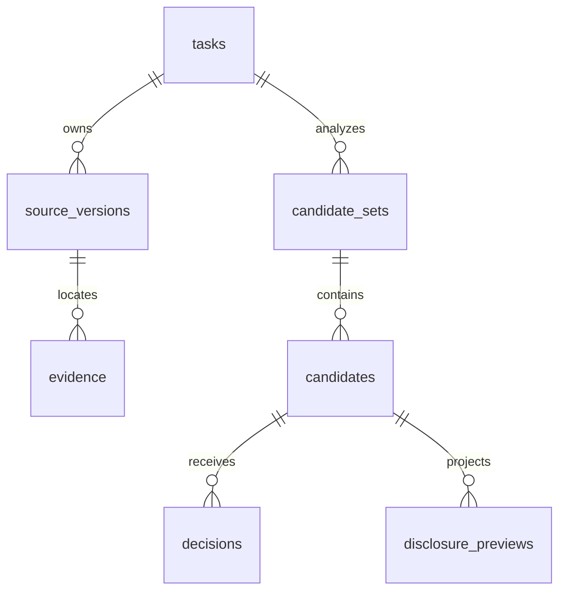
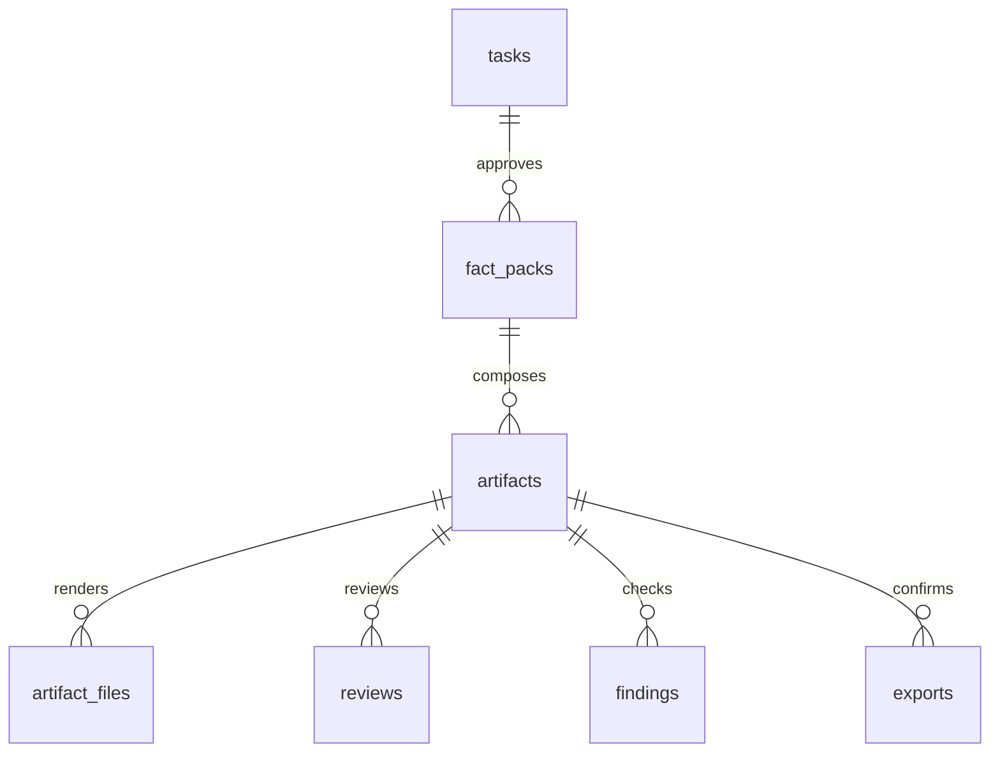
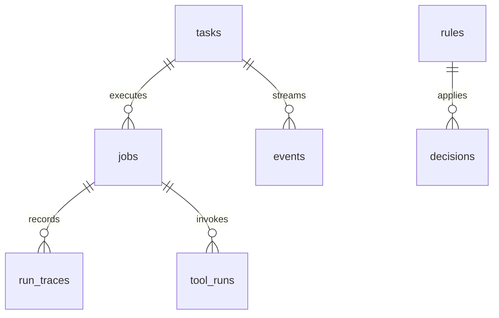

# 데이터 모델과 저장 계약

참조 초기 DDL: [schema.sql](../contracts/schema.sql). 공통 enum: [domain-contract.json](../contracts/domain-contract.json). DDL은 구현할 초기 migration의 출발점이며 앱 데이터베이스가 만들어져 있다는 뜻이 아니다. payload JSON의 의미·동일 작업 소속·불변 판본·SHA-256 일치는 서비스 계층에서 추가 검사한다.

## 1. 세 가지 데이터 경로

### 1.1 입력에서 공개 선택까지



후보의 근거 참조와 미리보기의 실제 source binding은 검증된 JSON으로 저장한다. 단순 FK만으로 원문 판본·바이트·scope가 일치한다고 판단하지 않는다.

### 1.2 결정에서 파일까지



같은 의미의 문서여도 출력 바이트가 달라지면 다른 해시다. 검토 대상은 document hash 또는 실제 파일 집합 hash 중 하나로 명확히 구분한다.

### 1.3 실행과 재사용



규칙은 이전 값을 복제하지 않고 변환과 조건만 저장한다. 원래 작업이 삭제되면 규칙의 provenance FK는 null로 바뀔 수 있으며 조건·변환은 그대로 내부에 남는다.

## 2. 테이블 사전

모든 시각은 UTC RFC 3339다. 생성 ID는 앱이 발급한 불투명 ID이며 `prefix_`와 128비트 난수의 소문자 hex를 기본으로 한다. 파일/내용 digest는 실제 바이트의 SHA-256 소문자 64자리다. 예제의 짧은 ID는 설명을 위한 값이다.

| 표 | 주요 칸 | 생성·수정 주체 / 수명 |
| --- | --- | --- |
| `schema_migrations` | version PK, applied_at | migration runner. 순방향만 |
| `tasks` | id, internal_title, project_id, purpose_id, **goal_variant**, recipient_id, audience, revision, phase, current_job/artifact/candidate_set, output_language, skill_ids_json, skill_set_hash, provider_mode, timestamps | TaskService. 현재 상태의 중심 |
| `task_snapshots` | (task_id,revision) PK, source_set_hash, policy_hash, skill_set_hash, snapshot_json | revision 생성 당시 입력·선택·기준의 불변 기록 |
| `source_versions` | id, task_id, source_id, version, source_slot, format, display_name, raw_bytes, size_bytes, sha256, parser_version, schema_id/version | SourceService. 원본 bytes 불변 |
| `task_sources` | (task_id,source_id) PK, current_source_version_id, included | 현재 작업에 포함된 source 판본 포인터 |
| `evidence` | id, task_id, source_version_id, locator_json, evidence_sha256 | 분석 전 parser. 특정 판본·위치 불변 |
| `jobs` | id, task_id, input_revision, kind, status, mode, snapshot_json, cancel_requested, result_ref, error_code, stage, timestamps | JobService/worker. provider_check만 task_id=null |
| `candidate_sets` | id, task_id, analysis_job_id, source_set_hash, created_revision | 분석 결과 한 묶음. 현재 채택 포인터 별도 |
| `candidates` | id, task_id, candidate_set_id, kind, uncertainty, relevance, origin, payload_json | 분석 결과 또는 사용자 후보. 내용 불변 |
| `disclosure_previews` | id, task_id, revision, candidate_id, representation_json, projection_bytes/hash, internal_bindings_json | 결정 전 서버 계산. 오래된 preview 승인 불가 |
| `decisions` | id, task_id, candidate_id, created_revision, supersedes_id, disposition, payload_json, applied_rule_id/version, expires_at, revoked_at | 사용자 결정 또는 기존 허용 규칙 재적용. 내용 불변, 철회 표시는 별도 |
| `current_decisions` | (task_id,candidate_id) PK, decision_id | 현재 결정 포인터. 철회 후 과거 allow로 되돌리지 않음 |
| `rules` | (id,version) PK, scope_hash, payload_json, created_from_task_id/decision_id, expires_at, revoked_at, created_at | 명시적 저장/새 판본. 정확값·원문 저장 불가 |
| `fact_packs` | id, task_id, revision, sha256, writer_payload_json, internal_mapping_json | 앱만 구성. writer와 내부 metadata 분리 |
| `artifacts` | id, task_id, revision, artifact_version, fact_pack_id, document_json/hash, artifact_set_hash, status, reproduction_json | 작성·편집·렌더링 판본. 확정 뒤 bytes 변경 불가 |
| `artifact_files` | id, artifact_id, relative_path, media_type, bytes, size_bytes, sha256, provenance_json | 렌더러. (artifact_id,path) 유일 |
| `reviews` | id, task_id, revision, artifact_id, target_kind, target_hash, mode, result, payload_json, reviewed_at | 모델 또는 사용자 의미 검토. 해시 결합 |
| `findings` | id, artifact_id, target_hash, detector_id, field_path, severity, resolution, payload_json | 검사기/예외 판정. 지정 finding만 해소 |
| `tool_runs` | id, task_id, revision, job_id, tool_id/version, input_hash, status, public_result_json, internal_diagnostics_json | 등록 도구. public_result도 승인팩 투영 후 사용 |
| `exports` | id, task_id, revision, artifact_id, artifact_set_hash, archive_bytes/hash, confirmed_at, invalidated_at/reason | 현재 파일 확정. 다운로드 시 현재 조건 재확인 |
| `events` | (task_id,seq) PK, revision, type, payload_json, created_at | 같은 트랜잭션의 상태 이벤트. 비민감 metadata만 |
| `idempotency_keys` | (method,path,key) PK, task_id, request_hash, response_status/json, created_at, expires_at | 중복 요청 결과. 기본 24시간. 작업 삭제 때 함께 제거 |
| `deletion_receipts` | task_id PK, request_key, request_hash, deleted_at, expires_at | 삭제 재전송 처리용 24시간 무내용 영수증. 원문·제목·응답 body 없음 |
| `run_traces` | id, job_id, role, prompt_version, provider_config_hash, elapsed_ms, usage_json, error_code, raw_request/response_payload, raw_payload_expires_at | 메타데이터 기본 저장. raw body는 디버그 opt-in, 24시간 후 제거 |

카탈로그(project·purpose·recipient·공개 template·등록 pack/tool)는 첫 버전에서 검증된 로컬 설정으로 제공한다. 구성은 시작 시 snapshot/digest를 기록한다. 사용자·조직·회원·청구 테이블은 없다. 세션과 일회 토큰은 메모리에만 두며 재시작하면 새 접속이 필요하다.

## 3. JSON 칼럼의 필수 의미

### 3.1 후보 payload

`proposed_statement`, `evidence_refs[]`, `source_version_ids[]`, `purpose_relevance`, `need_keys[]`, `conflict_group`, `structured_selector`를 가진다. need_keys는 등록된 문의 양식의 필수 정보 분류이며 모델이 붙였다는 이유만으로 의미 충족이 증명되지는 않는다. structured_selector는 앱이 source schema를 검사한 경우만 권한 재사용에 쓸 수 있다.

### 3.2 미리보기 internal_bindings

scope, source 판본/해시, evidence, representation, 생성한 공개 projection, 필요한 raw grant, 정확값 허용, 등록 확장 옵션, 재사용 가능 여부를 함께 저장한다. 클라이언트가 동일한 이름의 필드를 보내도 서버 binding을 덮어쓰지 못한다. projection_bytes는 사용자에게 실제 보여준 JSON/텍스트의 불변 바이트다.

### 3.3 결정 payload

```json
{
  "schema_version": "decision.v1",
  "scope": {"project_id":"project_demo","purpose_id":"vendor_support","goal_variant":"default","recipient_id":"vendor_lab","audience":"named_external","skill_set_hash":"<sha256>"},
  "source_version_ids": ["srcv_requests_1"],
  "representation": {"kind":"derived_table","transform_id":"series_direction_only.v1","parameters":{}},
  "approved_projection_sha256": "<sha256>",
  "preview_id": "preview_direction",
  "exact_value_grants": [],
  "raw_grants": [],
  "public_asset_grants": [],
  "reusable": true,
  "actor_kind": "human"
}
```

이 예제의 hash 표시는 실제 해시 자리에 들어갈 설명용 값이다. `actor_kind`는 human 또는 saved_rule이다. source/기준 변경으로 다시 계산한 자동 결정은 최초 규칙 허용과 applied_rule_id/version에 연결한다. exclude/defer에는 projection·grant가 없고 scope와 후보 참조만 저장한다.

정확값 grant: `source_version_id,source_sha256,evidence_id,canonical_value_sha256,scope`.
원문 grant: `source_version_id,source_sha256,start,end,hidden_ranges,rendered_sha256,scope,expires_at`.
공개 asset grant는 kind를 구분한다. fixed_asset/generated_input은 `catalog_asset_id/extension_option_id,contract_digest,public_projection_sha256,allowed_parameters,scope`로 실제 승인 입력·자산에 결합한다. tool_result_schema는 `tool_id,output_schema_digest,allowed_fields,target_digest,input_digest,scope`로 아직 생성되지 않은 합성 실행의 정형 결과 범위를 허용한다. 결과 생성 후 실제 파일 hash를 검토·최종 확인한다. 임의 원자료 값을 출력해도 된다는 허용은 아니다.

raw grant는 bytes를 권한 정보에 복제하지 않고 원자료 참조와 승인된 renderer 결과 해시를 보관한다. 권한 검사와 내부 저장소 접근으로 보호하며 단순 해시가 비밀 자체를 보호한다고 보지 않는다.

### 3.4 규칙 payload

scope, schema_id/version, source_slot, selector, transform_id/version, parameters, readable_summary, approved_by, status를 가진다. 원래 자료의 값·후보 문장·원문·고객 이름은 저장하지 않는다. 변환이 새 값의 그대로 공개를 허용하면 첫 PoC에서는 저장할 수 없다. `scope_hash`는 조회 인덱스이고 최종 허용 판단 때 구조화 필드를 다시 비교한다.

새 자료 분석을 채택하는 트랜잭션에서 snapshot에 포함된 유효 규칙을 재계산해 파생 결정을 만들 수 있다. 이 자동 산출은 같은 revision에 기록하며 task_snapshots는 변경하지 않는다. 후속 job은 현재 결정을 재검증해 별도 effective snapshot을 jobs.snapshot_json에 고정한다. 사용자가 ‘새 기준 적용’을 누르면 새 revision을 만든다. 복수 규칙이 서로 다르면 자동으로 하나를 우선하지 않고 질문한다.

### 3.5 파일 provenance와 검토

provenance는 앱만 쓴다. `origin=generated_config` 문자열을 사용자 문서가 포함한다고 provenance가 바뀌지 않는다. 최소 필드는 생성 tool ID/version, 입력 허용 ID, 공개 asset digest, 연결 DocAST block/slot, 생성 revision이다. 공개 manifest에는 provenance를 넣지 않는다.

reviews는 `target_kind=document`이면 document_hash, `bundle`이면 artifact_set_hash를 사용한다. 내부 issue 설명과 전달 가능한 fixed reason code를 분리한다. reproduction_json은 상태/reason/target digest/input digest/구조화 관찰을 보관하며 독립 환경이 없으면 성공 관찰을 꾸며 넣지 않는다.

## 4. DB 제약과 서비스 제약

DDL에서 강제: NOT NULL, enum CHECK, 양수 revision/version, bytes 길이, PK/UNIQUE, task/source/candidate/artifact FK, 삭제 cascade. FK는 각 connection에서 켠다.[R1]

서비스 트랜잭션에서 강제:

- `tasks.current_*`가 같은 작업의 실제 현재 객체인지 확인. 이 포인터는 순환 FK를 피하기 위해 DDL FK 없이 두며 반드시 단일 서비스에서 갱신한다.
- `current_decisions`의 decision이 같은 candidate를 가리키는지 확인. 같은 task라는 제약만으로 충분하지 않다.
- policy scope·원자료 판본/해시·만료·철회·확장 판본·실제 값/원문 범위 검사.
- candidate set에 연결된 근거·구조 선택자, artifact file allowlist, hash 재계산.
- 불변 payload 수정 금지. 변경은 새 레코드와 포인터 교체. 상태/철회/만료 표시는 허용된 칼럼만 갱신.
- `purpose_id`별 goal_variant 조합, reproduction_evidence의 등록 실행 환경/목표 완료 조건.

SQL 제약이 일부를 통과했다고 앱 권한 검사까지 통과한 것은 아니다. 모델이 DB에 직접 SQL을 쓰는 경로는 없다.

## 5. 트랜잭션 단위

| 동작 | 같은 commit에 들어가는 것 |
| --- | --- |
| 입력 batch | 모든 source 판본·현재 포함 포인터, revision/snapshot, 이전 결과 무효화, event, 멱등 응답 |
| 분석 채택 | CAS, candidate_set/candidates, 현재 포인터, 유효 규칙으로 만든 파생 결정, 다음 phase, event |
| 결정 batch | 모든 preview 검증, 새 decisions/current 포인터, 선택한 rules 생성, revision/snapshot, 무효화, event |
| 작성/검토 결과 적용 | CAS·대상 hash, artifact/review/finding/tool 결과, 현재 포인터·phase, event |
| 최종 확인 | 현재 결정·검사·hash 재검사, export, artifact/task 상태, event, 멱등 응답 |
| 기준 철회 | rules 표식, 영향 current 결정/결과 무효화, 각 task revision/snapshot/event |
| 작업 삭제 | 존재성/revision 확인, 실행 취소 표시, 해당 task 및 cascade 내용 삭제, 무내용 deletion_receipt |

DB 트랜잭션은 모델·실행기 대기 시간까지 유지하지 않는다. SQLite 단일 write transaction 특성 때문에 짧은 적용 구간으로 나눈다.[R2]

## 6. 해시와 직렬화

파일은 실제 bytes로 hash를 계산한다. 내부 구조화 payload는 `canonical_json.v1`이라는 서버 공통 함수 하나로 직렬화한다. 최소 계약은 map key의 UTF-8 사전순 정렬, 공백 없는 JSON, 배열 순서 유지, 정수 또는 decimal string, 유효 Unicode만, 중복 키 거부다. 문자열 escaping은 Go `encoding/json`의 기본 JSON 문자열 encoding을 사용하고 결과 끝의 LF는 제외한다. 함수별로 HTML escaping 설정을 달리하지 않는다. 언어를 바꾸면 기준 벡터와 동일한 bytes를 내야 한다.

`source_set_hash`는 included source_version_id와 sha256의 정렬 목록, `policy_hash`는 해당 snapshot 생성 시점의 scope·결정·규칙 판본·활성 조건의 목록, `skill_set_hash`는 등록 pack/template/tool digest의 정렬 목록으로 만든다. 목록의 전체 필드를 snapshot에 함께 저장한다. task snapshot은 revision 생성 시점을, job snapshot은 그 실행 직전 유효 상태를 나타낸다. 둘의 policy_hash가 다를 수 있으며 compose는 job snapshot과 현재 유효성 검사를 사용한다. hash 하나만으로 디버그하거나 원자료 존재 여부를 추정하지 않는다.

공개 manifest payload는 파일 `path,media_type,size,sha256`이며 자기 자신과 ZIP을 제외한다. `artifact_set_hash`는 manifest 포함 모든 공개 파일의 `path,size,sha256` 정렬 목록을 공통 직렬화한 SHA-256다. 다운로드는 저장된 파일/ZIP을 반환하며 매번 ZIP을 다시 생성하지 않는다.

## 7. 보존과 삭제

작업별 파일·원자료·근거·초안·검토·export·trace·event·멱등 응답을 함께 삭제한다. 삭제 이후 늦게 반환된 job은 task 없음으로 적용을 거부한다. `deletion_receipts`는 24시간 뒤 제거하고 원문 데이터가 없어야 한다. 이미 받은 파일과 OS 백업까지 삭제했다고 표시하지 않는다.

run_traces의 raw body는 기본 null이다. opt-in이면 expires_at을 함께 저장하고 24시간 후 body만 null로 지워 작업 측정 metadata를 유지한다. 일회 토큰·세션·CSRF·모델 API key는 이 DB에 저장하지 않는다. 사용자 삭제까지 보관하는 기본값은 실자료 운영 전 Q-POLICY에서 조직 정책과 맞춘다.

## 8. migration 완료 기준

첫 migration을 빈 SQLite에 적용하고 FK 검사, enum 거부, bytes 길이, 중복 파일 경로, cross-task FK, source 교체와 task 삭제 cascade를 시험한다. 기존 DB에 새 칼럼을 추가할 때 backfill·기본값·낡은 snapshot 처리 방식을 함께 적는다. 이 묶음의 SQL 실행 확인은 설계 검증이며 제품 API 통합시험을 대신하지 않는다.

## 공식 참고

- R1: [SQLite foreign keys](https://www.sqlite.org/foreignkeys.html)
- R2: [SQLite transaction](https://www.sqlite.org/lang_transaction.html)
