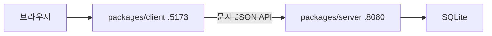

# 현재 구현 구조

사용자 요청에 따라 pnpm workspace의 TypeScript 서버·클라이언트 두 패키지로 초기화했다. 현재 구현 범위는 텍스트 문서 저장·조회뿐이다. 프로젝트 전체 제품 설계와 현재 동작을 구분한다.

- packages/server: Node 표준 HTTP 서버와 node:sqlite를 사용한다. documents 테이블에 id, text, created_at만 저장한다.
- packages/client: TypeScript DOM 코드와 최소 정적 파일 서버를 사용한다. /api 요청은 설정된 SERVER_ORIGIN에 전달한다. 서버 DB나 저장 구현을 import하지 않는다.
- 각 패키지는 독립 dev·start·build·typecheck·test 명령을 가진다. 루트는 pnpm workspace로 작업을 묶는다.
- Node·pnpm·just 버전은 mise.toml, 의존성 해석 결과는 pnpm-lock.yaml로 고정한다.
- just check가 QG를 직접 실행하고 QG가 타입·빌드·pnpm test를 호출한다. pnpm test에서 QG 전체 검사를 재호출하지 않는다.

분석·LLM·재생성·공개 결정·runner·이전 UI와 기존 백그라운드 실행 도구는 제거했다. 기존 업무 DB·비공개 설정·평가 결과는 보존하지만 현재 서버에서 읽지 않는다. 제품 설계와 참고용 계약은 향후 구현의 입력이며 현재 코드의 API를 정의하지 않는다.
