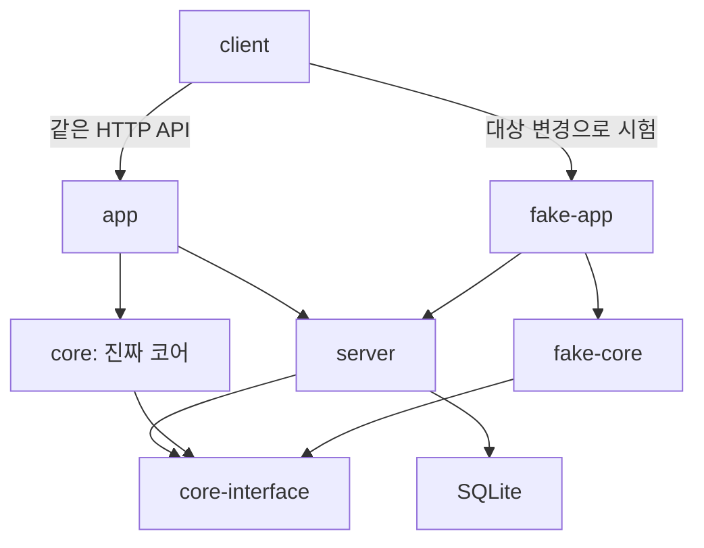

# 앱·서버 껍데기·코어의 경계

최종 조립 앱은 app, 연출용 가짜 앱은 fake-app이다. 두 앱은 같은 서버 껍데기와 코어 인터페이스를 사용하며 코어 구현을 각각 주입한다. 가짜 연출을 바꾸기 위해 실제 앱·진짜 코어를 수정하지 않는다.

| 패키지 | 책임 | 의존할 수 있는 구현 |
| --- | --- | --- |
| core-interface | 요청·응답 DTO, Core 인터페이스, 오류, 입력 검증 | 없음 |
| server | HTTP 경로·요청 검증·SQLite 저장, 주입한 Core 호출 | core-interface만 |
| fake-core | 연출용 문구·결과 템플릿 | core-interface만 |
| fake-app | 가짜 앱 조립·조절 화면·지연/실패 연출 | server, fake-core, core-interface |
| core | 개발할 진짜 코어 | core-interface만 |
| app | 최종 실제 앱의 서버·진짜 코어 조립과 기동 | server, core |
| client | 별도 웹 클라이언트·HTTP 프록시 | 현재는 구현 패키지 의존성 없음 |

server는 app·core·fake-core·fake-app을 import하지 않는다. Core를 생성자 인수로 받아 HTTP 입력을 전달한다. 진짜 core는 fake 구현을 import하지 않는다. app에는 fake 코드·조절 API·자동 fallback이 없다. workspace 의존성과 실제 TypeScript import를 architecture.test.mjs에서 검사한다. 다른 패키지의 src를 상대 경로로 직접 가져오는 것도 거부한다.

## 실제 앱과 연출 앱

실제 app은 기본 8080과 .local/data/safehandoff.sqlite를 사용한다. 앱 진입점은 설정 파일과 환경 변수에서 ModelClient를 구성해 RealCore에 주입한다. 설정 누락·호출 실패는 CORE_UNAVAILABLE이며 가짜 결과로 대체하지 않는다. 기존 문서 저장·조회는 그대로 동작한다. 진짜 구현은 packages/core 안에서 Core 계약을 구현하면 되고 server·fake-app 수정이 필요하지 않다.

fake-app은 기본 8081과 .local/data/demo.sqlite를 사용한다. 실제 DATABASE_PATH 환경 변수를 재사용하지 않으며 DEMO_DATABASE_PATH를 별도로 지정한다. /__demo에서 가짜 코어의 제목·도입·마무리와 연결 지연·앞으로 실패할 요청 수를 변경한다. 설정은 메모리에 있으며 재시작하면 초기화한다. 이는 모델·네트워크·의미 검토의 실제 품질 검증이 아니다.

가짜 연결 지연·실패는 fake-app 내부 connection.ts가 담당한다. 별도의 connector 앱 패키지는 없다. 가짜 연결부는 대상 Core를 주입받으며 fake-core의 구체 구현을 import하지 않는다. 취소된 지연 요청은 코어를 호출하지 않는다.

## 도구와 검증

Node·pnpm·just는 mise, 의존성은 pnpm-lock.yaml로 고정한다. 패키지 exports와 workspace 의존성으로 실행 경계를 만들고 pnpm build가 위상 순서로 빌드한다. 개발 시 development export condition으로 각 패키지의 TypeScript 원본을 실행한다. 배포 start는 빌드된 JS를 사용한다.

just check는 QG를 직접 실행하고 QG가 타입·빌드·pnpm test를 호출한다. pnpm test는 패키지별 Node 테스트와 의존성 경계·QG 정책 테스트를 실행한다. 공식 @slop-lab/qg-rules-js의 js preset을 적용하며 JS 타입 검사 표식·테스트 fixture 복제·패키지 매니저 혼용·pnpm lockfile 일치 등을 검사한다. 패키지 이름은 safehandoff 또는 @safehandoff/ 하위로 제한한다.

3라운드의 내부 TaskStore와 Docker 실행기 경계는 [축소 범위](round3-scope.md)를 따른다. task/decision 저장은 HTTP로 노출하지 않았으며 기존 문서 API와 독립적이다. Docker에는 고정 공개 toy 이미지와 등록 합성 입력만 전달한다.
