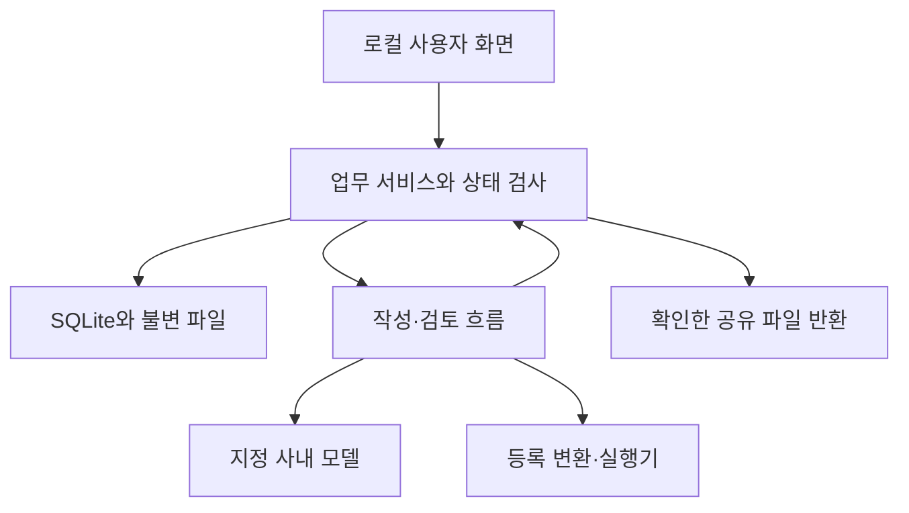

# 구현 구조와 실행 기본값

이 문서는 PoC의 **구현 기본안**이다. 사용자에게 특정 기술 선택을 이미 승인받았다고 표시하지 않는다. 기능·보안 계약을 바꾸지 않는 라이브러리 선택은 팀이 결정하고 잠금 파일과 [결정 기록](decisions.md)을 함께 갱신한다.

## 1. 가장 작은 실행 구성

| 영역 | 기본 선택 | 이유 / 경계 |
| --- | --- | --- |
| 앱 | Go 단일 프로세스, `net/http`, `html/template`, 순수 JS ES modules | 서버와 화면을 한 저장소에서 배포. 첫 버전에 별도 SPA 서버·마이크로서비스 없음 |
| 저장 | SQLite, `database/sql`, `modernc.org/sqlite` 드라이버 후보 | 작은 입력·출력 BLOB과 상태 변경을 같은 트랜잭션에 저장 |
| UI | 서버 HTML + JSON API + SSE 진행 상태 | 대기·질문·선택 변경·결과를 갱신. 원문 토큰 스트리밍 없음 |
| LLM | `Provider` 인터페이스, fixture / 사내 HTTP live 어댑터 | 특정 모델·서빙 런타임·GPU 불필요 |
| 비동기 실행 | DB에 job 기록 + 프로세스 내부 큐 | 작업당 실행 1개, 모델 동시성 1부터 시작 |
| 결정적 도구 | 등록된 Go 함수 | 수치·시간·파일·검사 로직을 모델 계산과 분리 |
| 별도 실행 | 등록 실행 파일을 제한된 Docker runner로 호출 | 재현·외부 검사기 확장만. 자동 이미지 다운로드·임의 shell 없음 |
| 테스트 | Go 단위/통합, fixture provider, 브라우저 시나리오, 별도 live 평가 | fixture 통과와 모델 유용성 검증을 분리 |
| 개발 품질 검사 | npm `@slop-lab/qg` 기본 recommended 규칙, 한국어·영어 문서 허용 | Node 24.21.0을 mise로 고정. `just test`/`npm test`에서 정책 회귀·Go·문서 검사 연결. 앱 런타임에는 불필요 |

Go의 HTTP 서버/클라이언트와 템플릿 기능은 표준 패키지에서 제공된다.[R1][R2] 여기서 선택한 모듈 구조와 처리 제한은 이 프로젝트의 설계다. 버전 번호는 구현 시작 시 실제 설치·호환성 확인 후 `go.mod`, `go.sum`, 이미지 digest에 고정한다. `latest`로 재현 환경을 운영하지 않는다.

## 2. 모듈 경계

| 패키지 / 경로 | 책임 | 직접 하지 않는 일 |
| --- | --- | --- |
| `cmd/safehandoff` | 설정 검증, DB, 로컬 접속, 서버·worker 기동 | 자료를 모델에 직접 전송 |
| `internal/domain` | enum·DTO·불변조건·공개 투영 | HTTP/DB 세부사항 |
| `internal/store` | migration·트랜잭션·CAS·이력 | 공개 의미 판단 |
| `internal/service` | 기능별 업무 함수와 권한/판본 검사 | provider별 JSON 해석 |
| `internal/provider` | fixture/live 변환, timeout, strict 응답 | 공개 결정·도구 실행 |
| `internal/workflow` | 역할별 입력 조립·반복 예산·복구 | 모델 출력의 임의 명령 실행 |
| `internal/tools` | 등록 변환·검사·안전한 runner 요청 | 사용자 자료에서 실행 경로 추론 |
| `internal/render` | DocAST·승인 슬롯 → Markdown/CSV/JSON/ZIP | 원자료 전체 폴더 압축 |
| `internal/httpapi` | 인증·CSRF·입력 검증·HTTP 오류·SSE | 클라이언트 supplied allow flag 신뢰 |
| `web` | 화면·접근성·변경 충돌·진행 표시 | 최종 승인 판단을 UI에서만 집행 |
| `packs` | 설치된 내부 지침/공개 양식/검사기 manifest | 권한 자체 부여 |
| `evaluation` | 별도 평가자 정답·수신자 자료·측정 | 앱 런타임 검색/도구의 입력 |

현재 코드의 평가 CLI는 `main.go`의 실행 모드·준비와 `cases.go`의 사례 실행·결과 공개로 나눕니다. HTTP 입력 처리는 `inputs.go`의 원자료, `candidates.go`의 후보, `decisions.go`의 미리보기·공개 결정으로 구분합니다. API 통합시험의 공통 도우미는 `harness_test.go`에 둡니다.

workflow는 `service.go`의 서비스·큐 접수, `run.go`의 작업 실행·결과 적용, `model.go`의 모델 호출 예산·trace, `review.go`의 검토 응답 검증으로 나눕니다. 화면은 `app.js`의 진입·조회·화면 전환, `workspace.js`의 작업 공간 렌더링·작업 동작, `disclosure-cards.js`의 공개 선택·미리보기·조건 해석을 사용합니다. 해석 중 갱신 억제 상태는 앱이 소유하고 카드에 상태 변경 함수를 전달합니다.

core JSON Schema는 [진입점](../contracts/core.schema.json)과 [세 모듈](../contracts/core/README.md)로 구성합니다. schema 엔진은 각 `$id`를 로컬 등록하며 참조를 해석할 때 네트워크를 사용하지 않습니다. 문서 검증기도 이 registry를 통해 모듈 참조·필수 키를 검사합니다.



이 그림은 사내 처리 경계 안의 앱 구조다. `E`는 사용자 브라우저에 반환하는 파일이며 외부 업체로 자동 보내는 서버가 아니다. 상세 네트워크 경계는 [보안](security.md).

## 3. 저장과 작업 실행

SQLite connection마다 foreign keys를 켜고 단일 DB 연결로 시작한다. WAL과 5,000 ms busy timeout은 운영 기본값이다. SQLite는 동시에 한 write transaction만 허용하므로 네트워크 호출 동안 트랜잭션을 유지하지 않는다.[R3][R4]

실행 순서는 다음과 같다.

1. 짧은 트랜잭션: 현재 revision·승인·확장 판본 확인 → 불변 snapshot·job 저장 → current_job 포인터 → commit.
2. 트랜잭션 밖: 모델·도구 호출. 취소·시간·출력·총 호출 예산 적용.
3. 짧은 트랜잭션: snapshot 유효성과 CAS 확인 → 결과·event·현재 포인터를 함께 저장.

앱 종료 뒤 queued/running 작업은 자동 성공으로 복구하지 않는다. `INTERRUPTED`로 기록하고 사용자가 새 job을 시작한다. 계산이 끝난 오래된 job은 내부 기록만 남기고 현재 결과를 바꾸지 않는다. 설정된 모델 전역 큐는 여러 작업 간 FIFO로 처리하며 사용자가 취소한 작업은 건너뛴다.

## 4. 설정 계약

개발 명령은 mise로 고정한 just 1.58.0과 루트 justfile을 사용한다. `just start`/`start-fixture`는 빌드 후 백그라운드로 실행하고 `stop`/`restart`/`status`/`logs`로 관리한다. 관리 상태·PID·명령 잠금·로그는 `.local/run`에 저장하며 원자료 DB와 분리한다. stop/restart는 관리 기록의 프로세스 시작 식별자를 확인하고 정상 종료를 요청한다. 15초 안에 종료되지 않으면 기록을 보존하며 임의 포트 소유 프로세스나 재사용된 PID를 강제 종료하지 않는다.

아래는 구현할 설정의 예다. config.json에는 환경 변수 이름을 지정하며 비밀 값은 실행 환경 또는 Git에서 제외한 `.env`에 둔다. 비밀은 UI·로그·export에 노출하지 않는다.

앱과 live evaluator는 실행 디렉터리의 `.env`를 자동으로 읽는다. 이미 존재하는 프로세스 환경 변수는 빈 값도 포함해 우선하며 `.env`가 없으면 오류 없이 계속한다. dotenv는 변수 할당·따옴표·export 구문을 해석하고 shell 명령은 실행하지 않는다. 읽기·파싱 오류에는 원문 줄이나 비밀 값을 표시하지 않는다. provider 검증 실패는 필드와 원인을 구분해 보고한다.

```json
{
  "schema_version": "config.v1",
  "server": {"listen": "127.0.0.1:8080", "allowed_hosts": [], "session_hours": 8},
  "data_dir": "./var/live",
  "provider": {
    "mode": "live",
    "adapter": "openai_compatible",
    "base_url_env": "SAFEHANDOFF_LLM_BASE_URL",
    "model_env": "SAFEHANDOFF_LLM_MODEL",
    "api_key_env": "SAFEHANDOFF_LLM_API_KEY",
    "response_mode": "text",
    "supports_system_role": true,
    "send_temperature": true,
    "output_limit_field": "max_tokens",
    "allow_plain_http": false,
    "max_input_bytes": 24576,
    "max_output_tokens": 2048,
    "request_timeout_seconds": 120,
    "max_attempts_per_step": 2,
    "global_concurrency": 1
  },
  "workflow": {"max_review_repairs": 2, "max_model_calls_per_run": 12},
  "limits": {"max_files": 10, "max_file_bytes": 262144, "max_task_source_bytes": 1048576, "max_export_bytes": 20971520},
  "debug": {"store_raw_model_payloads": false, "raw_payload_retention_hours": 24},
  "reproduction": {"enabled": true, "runner": "docker"}
}
```

형식은 제안하는 앱 설정이며 모델 API가 이 항목을 모두 지원한다는 뜻이 아니다. 사내 API 어댑터는 같은 내부 인터페이스를 구현한다. system role·temperature·출력 길이 매개변수 지원 여부를 설정으로 고정한다. 서버가 거부했다고 원자료를 다른 공급자에 재시도하지 않는다.

`max_input_bytes`는 UTF-8 요청 본문 한도이며 토큰 한도가 아니다. 실제 사내 모델 문맥 한도에 맞춰 조정한다. 지원하지 않는 매개변수는 설정 오류로 표시한다. 연결 점검은 비민감 짧은 요청만 사용한다. fixture 모드는 별도 `./var/fixture`와 명확한 배지를 사용하며 live DB를 fixture에 재사용하지 않는다.

## 5. 모델 인터페이스

```go
type Provider interface {
    Generate(context.Context, GenerateRequest) (GenerateResponse, error)
}
type GenerateRequest struct {
    Role string
    PromptVersion string
    System string
    InputJSON []byte
    MaxOutputTokens int
}
type GenerateResponse struct {
    Text string
    FinishReason string
    Usage *Usage
    ProviderRequestID string
}
```

provider가 준 tool call은 실행하지 않는다. `FinishReason`이 truncation이면 실패다. `Usage`를 제공하지 않으면 null이며 추정값으로 채우지 않는다. 요청/응답 원문 trace는 디버그 선택이 있을 때만 내부 저장한다. role별 입력 schema와 프롬프트 판본을 기록한다.

모델 JSON 파싱은 하나의 최상위 객체, 깊이 16, 응답 256 KiB, 후보 30개, 문서 블록 60개, 문자열당 8 KiB를 기본으로 한다. 단일 전체 JSON 코드 펜스만 제거할 수 있다. 중복 키·알 수 없는 키·후행 텍스트·타입 강제 변환·부분 JSON 추출은 금지한다. Go 기본 JSON decoder만으로 모든 엄격성 요구가 충족되는 것은 아니므로 token 사전 검사를 둔다.[R5]

## 6. 최소 도구 목록

| 도구 ID | 입력 | 결과 |
| --- | --- | --- |
| `derive_series_v1` | 검증된 series ref + 허용 변환 | 승인한 요약/방향/지수/선택 값 |
| `render_timeline_v1` | 승인 사건 + 시간 표현 | 새 사건 순서/허용 간격 표 |
| `render_approved_excerpt_v1` | 현재 raw grant | 지정 렌더링 바이트 |
| `make_synthetic_inputs_v1` | 공개 target 계약 + 승인 특성 | 새 입력과 provenance |
| `run_repro_v1` | 고정 target·input·oracle digest | 실행 상태·정형 판정 |
| `make_config_example_v1` | 공개 설정 schema + 승인 예시 조건 | 새 예시 설정 |
| `check_doc_ip_context_v1` | finding + 현재 provenance/decision | 그 finding의 예외 판정 |
| `scan_candidate_bundle_v1` | 실제 파일 집합 | 위치가 있는 보조 지적 |

도구 인수는 orchestration 코드가 만든다. 모델 출력에 ID가 들어 있어도 registry·역할·작업·현재 승인 교집합에 없으면 실행하지 않는다. 상세 예제와 추가 방법은 [확장](extensions.md).

## 7. 설치·실행 계약

구현 에이전트는 다음 명령을 제공한다. 아래 명령은 현재 문서 패키지에 앱 바이너리가 포함되어 있다는 뜻이 아니다.

```bash
go test ./...
go run ./cmd/safehandoff --config config.fixture.json
go run ./cmd/safehandoff --config config.live.json
go run ./cmd/safehandoff --check-config --config config.live.json
```

첫 실행은 listen 주소와 실제 접속 가능한 Host별 URL을 터미널에 표시한다. 기본은 loopback이며 명시한 wildcard/서버 IP 바인딩도 지원한다. wildcard 자체는 브라우저 URL로 표시하지 않고 서버 인터페이스 IP를 사용한다. 사용자 지정 접속 이름은 server.allowed_hosts로 허용한다. 일회 접속 절차는 F10의 구현 목표를 따른다. 자원을 CDN에서 받지 않도록 web asset을 포함한다. 빌드·이미지 준비는 허용된 준비 단계에서 하며 자료 처리 런타임에는 새 다운로드를 하지 않는다. source/DB 접근은 앱 내부 API로만 하며 `data_dir`를 정적 웹 경로로 만들지 않는다.

Docker가 없으면 기본 자료 작성은 동작한다. 재현 확장은 `not_run/no_environment`이고 사전등록한 필수 외부 검사기는 미수행으로 막는다. 임의 호스트 shell 실행으로 자동 대체하지 않는다. Docker `none`은 컨테이너에 loopback만 남기는 네트워크 구성을 제공한다.[R6] 이는 호스트 전체나 사내 모델 endpoint까지 통제하는 수단과는 별도다.

## 8. 변경할 수 있는 것과 같은 PR에서 바꿀 것

CSS 구조·private 함수명·DB 접근 라이브러리 등은 공통 계약을 유지하면 담당자가 결정할 수 있다. enum, 공개 수준 의미, 필수검사, revision 증가, 파일 해시, API DTO, 조회 권한, 재현 oracle을 바꾸면 spec/contracts/ERD/API/feature/QA를 함께 수정한다.

팀의 기존 기술 스택이 있으면 같은 계약 아래 교체할 수 있으나 두 스택을 병행 구현하지 않는다. 새로운 프레임워크·벡터 DB·멀티에이전트 프레임워크·정책 엔진은 이번 PoC 완료를 위한 선행 조건이 아니다.

## 참고한 공식 문서

- R1: [Go net/http](https://pkg.go.dev/net/http)
- R2: [Go html/template](https://pkg.go.dev/html/template)
- R3: [SQLite foreign keys](https://www.sqlite.org/foreignkeys.html)
- R4: [SQLite transaction](https://www.sqlite.org/lang_transaction.html)
- R5: [Go encoding/json](https://pkg.go.dev/encoding/json)
- R6: [Docker none network](https://docs.docker.com/engine/network/drivers/none/)

동작 계약의 권위는 본 문서 묶음이다. 공식 문서는 구현 수단의 실제 기능을 확인하는 참고이며 도구가 프로젝트의 보안 요구 전체를 대신한다고 해석하지 않는다.
