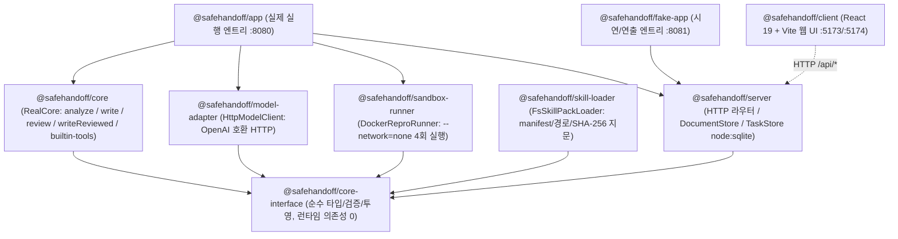

# SafeHandoff 아키텍처 - TypeScript 9개 패키지 구조와 의존성 경계

문서 버전: 2.0 / 기준일: 2026-10-31 / 상태: 현행 정본 / 연결: [prd.md](../product/prd.md), [decisions.md](../product/decisions.md), [api.md](api.md), [ERD.md](erd.md)

## 1. 패키지 구성과 의존성 방향

SafeHandoff는 `pnpm` 워크스페이스의 9개 TypeScript 패키지로 구성된다. 모든 도메인/실행 패키지는 순수 인터페이스 패키지인 `@safehandoff/core-interface`에만 의존하며, 화살표 역방향의 의존이나 순환 참조를 금지한다.

| 패키지 | 경로 | 핵심 책임 | 외부/내장 의존성 제약 |
| --- | --- | --- | --- |
| `@safehandoff/core-interface` | `packages/core-interface` | `Core`, `Engine`, `ModelClient`, `ReproRunner`, `SkillPackLoader`, `TranscriptSink` 포트 계약 및 `parseSources`, `composeFactPack`, `groundFacts`, `validatePackLayout`, `resolveToolAccess` 순수 함수 | 런타임 외부 패키지 0개, Node 내장 모듈(`node:*`) import 금지 |
| `@safehandoff/core` | `packages/core` | `RealCore`(`analyze`, `write`, `review`, `writeReviewed`, `reproduce`, `generate`), 프롬프트 조립, 응답 엄격 검증, `builtin-tools` 5종, `FileTranscriptSink` | `@safehandoff/core-interface`, `node:crypto`, `node:fs`, `node:path` |
| `@safehandoff/model-adapter` | `packages/model-adapter` | `HttpModelClient`: OpenAI 호환 `/v1/chat/completions` 호출, 타임아웃/버퍼 상한(1 MiB), redirect 차단, 고정 오류 코드 매핑 | `@safehandoff/core-interface` |
| `@safehandoff/sandbox-runner` | `packages/sandbox-runner` | `DockerReproRunner`: 입력 디렉터리 심볼릭 링크 거부, 등록 이미지 digest 검증, `--network=none` + `--read-only` 컨테이너 실행, 4회 실행 고정 oracle 판정 | `@safehandoff/core-interface`, `node:child_process`, `node:fs` |
| `@safehandoff/skill-loader` | `packages/skill-loader` | `FsSkillPackLoader`: `O_NOFOLLOW` 경로 검증, `manifest.json`/참조 파일 SHA-256 지문 계산 및 설치 pin 대조(`load`/`verify`), `skillSetHash` | `@safehandoff/core-interface`, `node:crypto`, `node:fs` |
| `@safehandoff/server` | `packages/server` | `createServer`: HTTP 라우팅(`/api/health`, `/api/core/status`, `/api/core/generate`, `/api/documents`), `DocumentStore` 및 `TaskStore`(`node:sqlite`) | `@safehandoff/core-interface`, `node:http`, `node:sqlite` |
| `@safehandoff/app` | `packages/app` | 실제 서버 실행 조립(`RealCore` + `HttpModelClient` + `DockerReproRunner` + `DocumentStore`, 기본 `:8080`) | `server`, `core`, `model-adapter`, `sandbox-runner` |
| `@safehandoff/fake-app` | `packages/fake-app` | 시연용 `FakeCore` + 설정 화면(`/__demo`, 기본 `:8081`). workflow 미연결 | `server`, `fake-core`, `core-interface` |
| `@safehandoff/client` | `packages/client` | React 19 + Vite 프론트엔드(`ApiClient` + 웹 화면) | `react`, `react-dom` |

---

## 2. 핵심 데이터/권한 경계

1. **원자료와 작성기(`Writer`) 분리 (`INV-04`)**:
   - 원자료(`SourceFile`)와 내부 근거(`Evidence`)는 `parseSources()`와 `RealCore.analyze()`에서만 읽는다.
   - 사용자가 선택한 결정(`Decision`)과 활성 규칙(`Rule`)은 `composeFactPack()`을 통해 불투명 `fact_id`만 가진 `FactPack`(`fact_pack.v1`)으로 투영된다.
   - `RealCore.write()`는 오직 `FactPack`만 모델에 전달한다.
2. **결정적 Grounding과 기본 거부 검토 (`INV-05`, `INV-10`)**:
   - `groundFacts(context, pack, now)`는 모든 공개 사실이 유효한 신규 승인(`fresh_decision`) 또는 범위/만료/철회/목표(`goal_variant`)가 검증된 재사용 규칙(`reused_rule`)에 연결되어 있는지 먼저 코드로 확인한다.
   - 근거가 없거나 만료/철회된 결정이 하나라도 있으면 **모델을 호출하기 전에** 즉시 `needs_decision` (`NEEDS_DISCLOSURE_DECISION`)으로 차단한다.
   - `RealCore.writeReviewed()`는 `needs_changes` 발생 시 리뷰어의 자유 설명 문장을 제거하고 고정 `reason_code`와 승인된 `fact_id`/`block_id`만으로 최대 1회 자동 수리를 수행한다.
3. **도구 권한 교집합과 샌드박스 실행 (`INV-02`, `INV-15`)**:
   - `resolveToolAccess()`는 `앱 등록 도구 교집합 역할 허용 목록 교집합 활성 SkillPack 교집합 현재 승인 grant`의 교집합만 허용한다.
   - 컨테이너 실행(`DockerReproRunner`)은 셸 문자열 대신 고정 인자 배열(`execFile`)을 사용하며 호스트 DB/모델 API 키/네트워크를 마운트하지 않는다.

---

## 3. 분리된 실행 환경 (App / Fake-App / Client)

| 실행 대상 | 명령 | 기본 주소 | 용도 |
| --- | --- | --- | --- |
| 실제 앱 전체 | `just app` | `http://127.0.0.1:5173` | 설치·빌드 후 API와 웹을 함께 실행·종료 |
| 실제 서버 | `just api` | `http://127.0.0.1:8080` | 사내/로컬 LLM 및 SQLite 연동 실행 |
| 시연용 서버 | `just fake-app` | `http://127.0.0.1:8081` | 외부 LLM 없이 고정 Core 응답과 설정 확인 (`/__demo`), workflow는 미연결 |
| 클라이언트 (실제 연결) | `just web` | `http://127.0.0.1:5173` | `/api` 요청을 `:8080`으로 프록시 |
| 클라이언트 (시연 연결) | `just fake-client` | `http://127.0.0.1:5174` | `/api` 및 `/__demo` 요청을 `:8081`로 프록시 |
