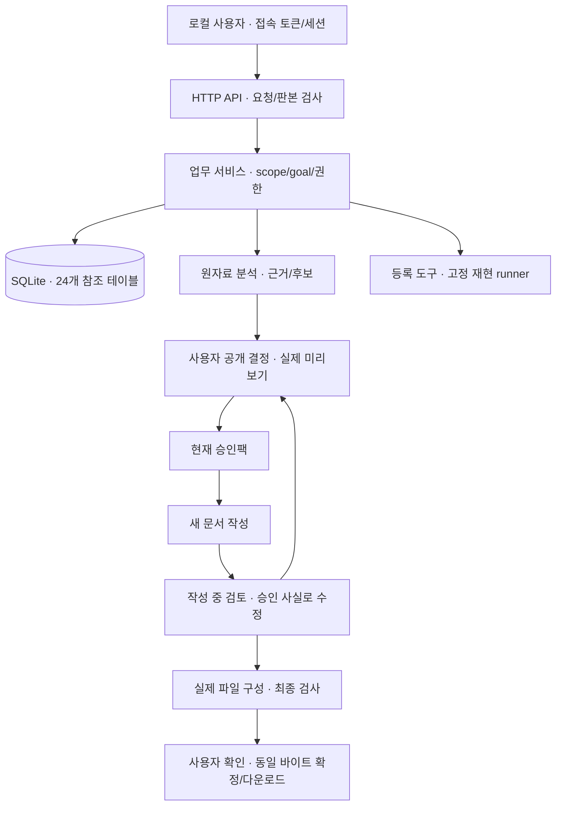

# 구조와 설계

구현 구조는 [architecture.md](architecture.md), 데이터 구조는 [ERD.md](ERD.md), 실행 경계는 [security.md](security.md)를 단일 기준으로 사용합니다. 이 문서는 그 설계의 개요입니다. 현재 코드의 차이·미완료 항목은 [검증보고서](검증보고서.md)에 기록합니다.

## 처리 구조

원자료·내부 제목·수신자 이름·분석 대화는 writer에 전달하지 않습니다. 승인된 사실·표·불투명 슬롯과 공개 양식으로 전체 새 작성을 수행합니다. 원문은 앱이 승인 슬롯에 삽입합니다. 검토 설명이나 도구 stderr를 수정 프롬프트에 복사하지 않습니다.

## 상태와 저장

Task scope에는 프로젝트·목적·goal_variant·수신자·audience·지침 hash가 포함됩니다. 목표별 필수 정보와 공개 선택을 함께 검증합니다. 관찰 문의는 재현 환경 없이 확정할 수 있지만 reproduction_evidence 목표는 지정 재현 확인이 필요합니다. 목표 변경은 명시적 사용자 동작과 새 revision·재분석·재결정으로 처리합니다.

[참조 DDL](../contracts/schema.sql)의 24개 테이블과 [ERD](ERD.md)를 따릅니다. 원자료·후보 집합·결정·승인팩·파일·검토·실행을 각각 불변 판본으로 보존합니다. revision 생성 시점의 task snapshot과 실행 직전의 job snapshot을 구분합니다. 현재 집계형 `tasks.payload_json` 저장은 이 목표 구조로 전환할 대상입니다.

SQLite 단일 연결·foreign_keys·WAL·busy_timeout 5000ms로 시작합니다. 자료 디렉터리는 0700, DB 파일은 0600입니다. 짧은 트랜잭션에서 스냅샷·job을 저장하고 모델/도구 호출은 밖에서 실행합니다. 결과 적용은 revision·current_job·취소·현재 승인/지침·대상 해시를 검사하는 CAS로 보호합니다. 재시작의 queued/running은 failed/INTERRUPTED이며 자동 성공·자동 재개하지 않습니다.

## 파일·재사용·보존

공개 결정은 서버 미리보기 binding과 실제 hash로 구성합니다. 정확값·원문은 현재 자료에만 적용합니다. 저장 기준은 scope·schema/version·selector·transform/version이 맞을 때 새 자료로 다시 계산합니다. 변경·철회·만료는 이전 결과와 export를 무효화하며 사람이 의미 검토해도 hard check를 우회할 수 없습니다.

최종 검토한 파일과 ZIP의 저장 바이트를 확정·반환합니다. 다운로드 시 모델이나 렌더러를 다시 실행하지 않습니다. raw 모델 trace는 기본 off이며 debug opt-in 때 최대 24시간 보관합니다. 작업 삭제는 원문·결정·결과·trace·관련 멱등 내용까지 제거하고 비민감 저장 기준은 별도로 유지합니다.

## 실행과 모듈 경계

앱은 사내 환경에서 실행하며 원자료를 읽는 작업 환경의 인터넷을 차단하고 지정 사내 모델 연결만 허용합니다. loopback 바인딩·Host/Origin/CSRF 검사만으로 이 OS 네트워크 경계가 검증됐다고 판단하지 않습니다.

도구는 registry·역할·팩·현재 공개 결정의 교집합으로 허용합니다. Docker runner는 등록 digest·network none·non-root·read-only root·CPU/메모리/PID/시간/출력 제한을 집행합니다. 고정 target의 실제 파일 결과로 재현을 판정합니다.

업무 서비스·provider·workflow·정책·렌더링·registry의 책임은 [모듈 표](architecture.md#2-모듈-경계)를 따릅니다. private Go 패키지 이름은 조정할 수 있지만 DTO·권한·상태·검증 계약을 분리된 정의로 복제하지 않습니다.
