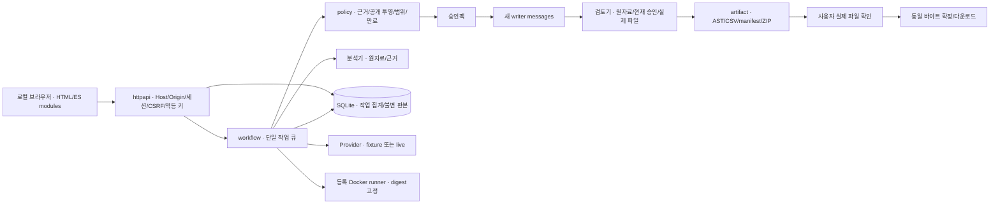

# 구조와 설계

## 처리 구조

원자료·수신자 표시 이름·내부 제목·분석 대화는 writer 요청에 넣지 않습니다. 공개 목적별 고정 brief, 승인 사실, 허용 표, 불투명 excerpt 슬롯 ID만 보냅니다. 인용 바이트는 별도 최종 렌더러가 삽입합니다. 검토기 내부 설명·stderr는 작성기로 돌아가지 않습니다. 수정은 승인팩으로 전체 새 작성 요청을 보냅니다.

## 패키지별 책임

| 경로 | 책임 |
| --- | --- |
| `cmd/safehandoff` | 설정, loopback 서버, DB migration, 종료·demo seed |
| `internal/domain` | 작업·판본·근거·문서 계약, strict JSON, 해시·ID |
| `internal/policy` | 방향/비율/정확한 값/원문 투영, 범위·철회·만료, 재사용 조건 |
| `internal/store` | SQLite, 트랜잭션·CAS, 불변 revision 스냅샷, 재시작 복구 |
| `internal/workflow` | 전역 순차 호출, 입력/호출/수정 예산, 늦은 결과 차단 |
| `internal/llm` | 교체 가능한 Provider, text HTTP 어댑터, 명시적 fixture |
| `internal/artifact` | AST 검증, 새 숫자 검사, 결정적 파일·manifest·ZIP, asset digest |
| `internal/tools` | 새 합성 입력, 특정 finding의 문맥 검사 |
| `internal/runner` | 고정 이미지·바이너리 digest, Docker 자원·네트워크 제한, 재현 oracle |
| `internal/httpapi` | 별도 API DTO, 세션·CSRF·멱등 키, 업로드·SSE·파일 응답 |
| `web` | 서버 HTML, 별도 API 모듈과 화면 모듈, 한국어 UI·접근성 |
| `prompts`, `contracts`, `skills` | 버전 역할 지침, JSON 계약, 내장 제품 팩 |
| `fixtures/public/targets/toyrecord` | 외부 의존성 없는 공개 repro 하위 모듈 |
| `cmd/safehandoff-eval`, `evaluation` | 제품과 분리한 자동 평가·실행 기록·수신자 정답 |

## 저장 방식의 선택

명세의 테이블별 정규화 모델 대신 첫 구현은 `tasks.payload_json`에 작업 집계 전체를 저장하고 `task_snapshots(task_id,revision)`에 불변 판본을 보관합니다. 바이너리 자료·파일은 JSON의 base64로 같은 SQLite BLOB에 들어갑니다. 작은 로컬 PoC에서 현재 포인터·결정·파일·이벤트를 한 트랜잭션으로 바꾸는 데 집중했습니다. 별도 `rules`, `catalog`, `idempotency_keys`, `schema_migrations` 테이블을 둡니다. 따라서 명세 §8의 테이블 구성을 그대로 구현한 것은 아닙니다.

장점은 부분 저장·파일시스템 불일치를 줄이는 것입니다. 비용은 작업 JSON 전체 읽기·쓰기, 긴 이력의 크기 증가와 제한적인 조회 성능입니다. 다중 사용자·대용량 도입 전에는 정규화 migration이 필요합니다. source/evidence/decision/artifact ID의 작업 소속은 앱에서 검사합니다.

SQLite는 단일 연결·foreign_keys·WAL·busy_timeout 5000ms를 사용합니다. 자료 폴더는 0700, DB는 0600입니다. 모델 호출 중에는 DB 트랜잭션을 열지 않습니다. 작업 revision뿐 아니라 current_job_id·cancel_requested도 결과 적용 때 다시 확인합니다.

멱등 키는 처리 전 예약합니다. 동일 키·동일 요청은 저장 응답을 재생하고, 다른 요청이면 409입니다. 예약 뒤 프로세스가 죽어 응답이 확정되지 않은 요청은 `IDEMPOTENCY_INDETERMINATE`로 차단합니다. 자동 재적용하지 않는 안전한 실패 방식이며, 원자적 응답 outbox 방식은 후속 과제입니다.

## 파일과 권한

결정은 미리보기의 task/candidate/revision/representation/원문 grant/해시와 서버 재계산 결과가 일치해야 저장됩니다. 선택 변경 시 전체 artifact를 stale로 표시하고 export ID를 해제합니다. 재사용은 scope와 검증된 CSV 헤더·slot·값 열 선택자가 일치하는 변환에만 적용합니다. 실제 값과 원문은 재사용하지 않습니다.

확정은 현재 승인 활성 상태·문서 해시·파일 집합 해시·검토 대상 해시를 검사합니다. 다운로드는 모델이나 렌더러를 다시 실행하지 않고 저장된 파일·ZIP 바이트만 반환합니다. 사람이 하는 의미 검토도 이 hard check를 우회할 수 없습니다.

Docker는 `scratch`, non-root, read-only root, network none, cap-drop ALL, no-new-privileges, CPU 1, 메모리 256 MiB, PID 64, tmpfs 32 MiB, 15초·출력 제한을 사용합니다. 호스트와 daemon의 볼륨 가시성이 다른 환경에서 나온 첫 실패를 보존했습니다. 고정 `probe`가 컨테이너 안에서 대상 프로세스를 실행하고 실제 `result.bin` 존재·바이트를 읽어 외부 판정기에 반환합니다. 모델 설명이나 대상 stdout의 성공 주장만으로 파일 저장을 인정하지 않습니다.

## 남은 경계

문서의 새 숫자·참조·권한·판본은 결정적으로 검사하지만, 새로운 비수치 주장·과장·추론은 의미 검토가 필요합니다. fixture reviewer는 고정 pass 응답입니다. 실제 모델 품질이나 모든 정보 유출 방지를 보장하지 않습니다. OS·운영자·설정된 사내 모델 서비스는 신뢰 환경입니다.
